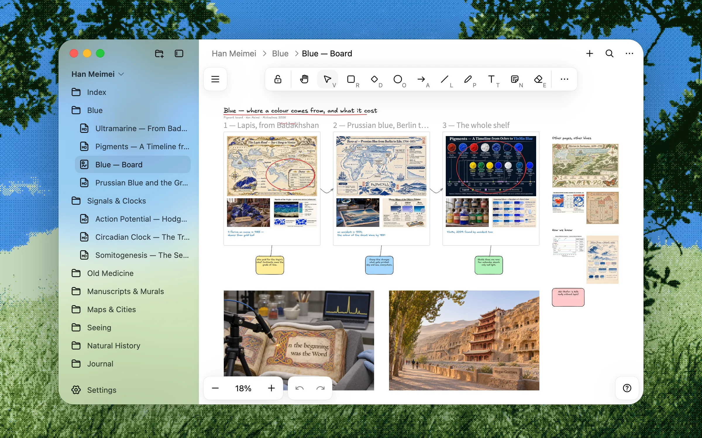

<h1 align="center">Quiet.md</h1>

  <b>빠르고 조용한, 내 컴퓨터에 있는 노트.</b> 
  Rust + GPUI로 직접 그리는 네이티브 노트 앱입니다. 진짜 폴더, 입력하는 대로 정리되는 Markdown, 그리고 노트 안의 화이트보드. 무료 오픈 소스입니다.

  <a href="README.md">English</a> · <a href="README.zh-CN.md">简体中文</a> · <a href="README.zh-TW.md">繁體中文</a> · <a href="README.ja.md">日本語</a> · 한국어 · <a href="README.es.md">Español</a> · <a href="README.fr.md">Français</a>

  
  
  
  
  
  

  
  &nbsp;
  
  &nbsp;
  

  <a href="https://quiet.md/?lang=en"><b>웹사이트</b></a> ·
  <a href="#다운로드"><b>다운로드</b></a> ·
  <a href="#기능">기능</a> ·
  <a href="#성능">성능</a> ·
  <a href="CONTRIBUTING.md">기여하기</a>

  

> [!NOTE]
> Quiet.md는 **베타** 단계이며 빠르게 바뀌고 있습니다. 버그를 발견했거나 아이디어가 있다면 [이슈를 남겨 주세요](https://github.com/s1dashu/quiet-md/issues). 풀 리퀘스트를 보내 주시면 더 좋습니다.

## Quiet.md를 쓰는 이유

**📁 노트는 그냥 파일입니다.** 계정도 클라우드도 없고, 기본적으로 네트워크로 아무것도 보내지 않습니다(선택 사항인 업데이트 확인, 앱과 명령줄 도구 `quiet`가 하루에 한 번 보내는 익명 사용 횟수(앱을 연 횟수 같은 횟수만 보내며 ‘설정 › 일반 › 익명 사용 통계’에서 끌 수 있음), 화이트보드에 한중일 손글씨 글꼴이 처음 필요할 때나 내려받을 수 있는 문서 글꼴을 고를 때 받는 글꼴 파일 제외). 사이드바의 폴더는 모두 디스크에 있는 진짜 폴더이고, 노트는 각각 제목으로 이름 붙은 파일입니다. Markdown은 `.md`, 서식 있는 문서는 `.xml`입니다. iCloud, Git 등 원하는 방법으로 동기화하세요. Quiet.md를 그만 써도 파일은 그 자리에 그대로 있습니다.

**⚡ 네이티브라서 빠릅니다.** 인터페이스 전체를 Rust와 [GPUI](https://www.gpui.rs/)가 GPU로 그립니다. Electron도 WebView도 없습니다. 100만 자짜리 노트에서도 입력은 프레임당 약 5 ms이고, 120 Hz 디스플레이가 한 프레임에 주는 시간은 8.3 ms입니다.

**✍️ 쓰기와 그리기를 한곳에서.** `#`, `-`, `[]`, `>`를 입력하면 Markdown이 알아서 정리됩니다. 글로 부족할 땐 노트 안에 화이트보드를 바로 넣으세요. 서식 있는 노트는 Feishu(Lark) DocxXML 형식으로 저장되므로 Feishu나 웹 페이지에서 붙여 넣어도 구조가 유지됩니다.

## 기능

### 쓰기

  

제목, 목록, 할 일, 인용, 콜아웃, 단 나누기, 셀 병합이 되는 표, 구문 강조 코드, LaTeX 수식, 이미지, 파일, 커버. 쓰는 동안 Markdown 단축 입력이 동작하고, 나머지는 `/` 메뉴에 있습니다. 다른 노트를 멘션하면 링크가 되고, 그 노트에는 백링크가 표시됩니다. 데이터베이스는 단일 선택, 날짜, 숫자, 수식, 조회, 관계 등의 필드로 기록을 담고, 보기마다 필터·정렬·그룹을 쓸 수 있으며, ‘노트’ 열의 각 칸은 진짜 노트입니다. ‘…’ 메뉴에는 집중 모드, 타자기 모드, 문단 집중이 있고, ‘보기’ › ‘확대’는 본문만 키웁니다.

### 그리기

  

보드는 Excalidraw에서 이식한 화이트보드입니다. 도형, 계속 붙어 있는 화살표, 자유 그리기, 텍스트, 스티커 메모, 프레임, 이미지. 노트 안에 넣거나, excalidraw.com에서 열리는 `.excalidraw` 파일로 따로 둘 수 있습니다. 트랙패드 핀치로 확대·축소되고, 도형 10,000개가 있는 보드도 부드럽게 움직입니다.

### 진짜 폴더로 정리하기

사이드바는 최상위 폴더별로 묶입니다. 폴더를 열면 그 페이지에 하위 폴더가 안이 들여다보이는 종이 묶음으로 보이고, 목록 보기는 원하는 열로 정렬됩니다. 컴퓨터의 어떤 폴더든 **폴더 추가**로 그 자리 그대로 씁니다. 노트를 폴더 위에 잠시 올려 두면 폴더가 열리고, 폴더 안에 폴더를 넣을 수 있으며, 페이지와 폴더를 다른 최상위 폴더로도 옮길 수 있고, 이동은 언제나 실행 취소할 수 있습니다. 노트를 사이드바 맨 위에 고정하고, 검색 아이콘이나 `⌘ J`로 모든 제목과 본문을 검색하고, 노트 안에서 찾아 바꾸기를 할 수 있습니다. 정규 표현식도 쓸 수 있습니다. 삭제한 노트는 먼저 휴지통으로 가고, 며칠 둘지는 직접 정합니다. 따로 연 Markdown 파일은 자기 창에서 그 자리 그대로 편집합니다.

### 노트 가져오기

‘다른 앱에서 가져오기…’(파일 메뉴)는 이 컴퓨터의 Obsidian, Logseq, iA Writer, Typora 라이브러리와 SiYuan 작업 공간을 찾아 복사해 옵니다. 원본은 건드리지 않습니다. Obsidian의 `[[위키링크]]`도 그대로 동작해서, 클릭하면 가리키는 노트가 열립니다. 나중에도 Markdown 파일과 폴더를 폴더 페이지나 사이드바의 폴더로 바로 끌어다 놓을 수 있습니다. 노트는 Markdown이나 PDF로 내보내거나 바로 인쇄할 수 있습니다.

### 그 밖에

- **버전 기록**: 노트는 저장할 때마다 스냅숏을 남깁니다(기본 20개, 최대 30개). 하나를 열면 바뀐 부분을 그 자리에서 보여 주고, 클릭 한 번으로 복원하거나 이름을 붙일 수 있습니다.
- **빠른 노트**: macOS에서는 전역 단축키(기본 `⌥ Space`)로 어떤 앱 위에서든 작은 노트 창을 엽니다.
- **모양**: Craft, Feishu, Notion, Obsidian 네 가지 기본 스타일에 각각 다크 모드가 있고, CSS로 직접 만들 수도 있습니다([docs/THEMES.md](docs/THEMES.md)). 인터페이스 글꼴과 문서 글꼴도 고를 수 있습니다.
- **단축키**: `⌘ /`를 누르면 모든 단축키가 보이고, 무엇이든 바꾸거나 지울 수 있습니다. Windows와 Linux에서는 ⌘ 대신 Ctrl, ⌥ 대신 Alt를 씁니다.
- **명령줄과 에이전트**: 앱에 함께 들어 있는 명령줄 도구 `quiet`로 Claude Code, Codex 같은 AI 에이전트가 앱과 같은 엔진으로 라이브러리를 읽고 씁니다. ‘설정 › 에이전트 연결’에는 에이전트에게 붙여 넣을 한 줄이 있어 에이전트가 스스로 설치하고, macOS에서는 명령줄 도구를 한 번에 설치합니다. 자세한 내용은 [영어 README](README.md#work-with-agents)를 보세요.
- **언어**: 영어, 중국어 간체, 중국어 번체, 일본어, 한국어, 스페인어, 프랑스어, 아랍어, 튀르키예어. 아랍어는 글자가 제대로 이어지고 오른쪽에서 왼쪽으로 표시됩니다.
- **정리**: **설정 › 라이브러리**에서 어떤 노트도 더 이상 쓰지 않는 이미지와 파일을 찾아, 확인한 뒤에 옮깁니다.
- **업데이트**: 새 버전은 서명을 검증한 뒤 앱 안에서 설치됩니다. 자동 확인은 끌 수 있습니다.

## 로드맵

- [x] 서식 있는 문서: 제목, 목록, 콜아웃, 표, 단 나누기, 코드, 수식, 이미지, 파일
- [x] Markdown 파일을 그 자리에서 열고 편집
- [x] 보드: 손으로 그린 듯한 다이어그램과 스케치, 노트 안에서도 따로도
- [x] 어떤 폴더든 그 자리에서 열어 사이드바에 나란히
- [x] Obsidian, Logseq, SiYuan, Typora, iA Writer, 아무 Markdown 폴더에서 가져오기
- [x] 글쓰기 모드: 집중 모드, 타자기 모드, 문단 집중
- [x] 테마, 다크 모드, 9개 언어
- [x] AI 에이전트를 위한 `quiet` CLI와 스킬
- [ ] 데이터베이스(진행 중)
- [ ] Mermaid 다이어그램(진행 중)
- [ ] 모바일 지원: iPhone, iPad, Android(진행 중)
- [ ] 기기 간 동기화(진행 중)
- [ ] 문서 속성
- [ ] 웹 클리퍼

## 다운로드

  
  &nbsp;
  
  &nbsp;
  

| 플랫폼 | 패키지 | 요구 사항 |
|---|---|---|
| **macOS**(Apple Silicon) | [quiet-md-macos-arm64.dmg](https://download.quiet.md/latest/quiet-md-macos-arm64.dmg) | macOS 13 이상 |
| **Windows**(x64) | [quiet-md-windows-x64-setup.exe](https://download.quiet.md/latest/quiet-md-windows-x64-setup.exe) | Windows 10 버전 1809 이상 |
| **Linux**(x86_64, 실험적) | [quiet-md-x86_64.AppImage](https://download.quiet.md/latest/quiet-md-x86_64.AppImage) | glibc 2.35 이상(Ubuntu 22.04 이상) |
| **macOS**(Intel) | [quiet-md-macos-x86_64.dmg](https://download.quiet.md/latest/quiet-md-macos-x86_64.dmg) | macOS 13 이상 |

- **macOS**: `.dmg`를 열고 `quiet.md.app`을 옆의 응용 프로그램 바로 가기로 끌어다 놓은 뒤, 응용 프로그램 폴더에서 엽니다. 앱과 디스크 이미지는 Apple의 서명과 공증을 받았습니다. Releases 페이지의 `.zip`은 같은 앱이며, 앱 내 업데이트가 내려받는 파일입니다.
- **Windows**: 설치 프로그램을 실행합니다. 기본적으로 현재 사용자에게만 설치되며, 제거해도 노트는 지워지지 않습니다. 처음 실행할 때 SmartScreen 창이 뜨면 **추가 정보 → 실행**을 누르세요.
- **Linux**(실험적): `chmod +x quiet-md-*.AppImage` 후 실행합니다. FUSE가 없으면 `--appimage-extract-and-run`을 붙이세요. AppImage 0.1.10부터는 앱 안에서 업데이트할 수 있고, 그 이전 Linux 버전은 한 번 직접 설치해야 합니다. 직접 써 보는 테스트는 지금까지 Wayland의 Omarchy에서만 했습니다. 자세한 내용은 [Linux 안내](CONTRIBUTING.md#linux-experimental)를 참고하세요.

[Quiet.md](https://quiet.md/?lang=en)에서도 내려받을 수 있습니다. 모든 릴리스와 SHA-256 체크섬은 [GitHub Releases](https://github.com/s1dashu/quiet-md/releases)에 있습니다.

처음 실행하면 도큐멘트의 **Quiet Notes** 폴더(이전 버전이 만든 `Quiet.md` 폴더가 있으면 그 폴더)가 바로 열리고, 그 안에 **Getting started** 가이드가 들어 있습니다. 주요 기능을 10분 만에 둘러보는 안내입니다. 이미 있는 노트는 덮어쓰지 않습니다. 다른 폴더 추가나 다른 앱의 노트 가져오기는 언제든 파일 메뉴에서 할 수 있습니다.

## 성능

**100만 자**, 549개 장으로 이루어진 복합 문서에서 100번 연속으로 작업했을 때의 프레임 처리 시간입니다.

| 작업 | P50 | P95 |
|---|---:|---:|
| ⌨️ 입력 | **5.06 ms** | 5.78 ms |
| ⌫ Backspace | **4.99 ms** | 5.55 ms |
| 🖱️ 스크롤 | **2.08 ms** | 4.14 ms |

120 Hz 디스플레이에서 한 프레임에 쓸 수 있는 시간은 8.3 ms입니다. 100만 자 문서의 P95에서도 여유가 남습니다.

| | |
|---|---|
| macOS 다운로드 | 약 18 MB |
| Windows 설치 프로그램 | 약 14 MB |
| 런타임 | WebView 없음, Electron 없음, 백그라운드 서비스 없음 |

Apple M5 Pro / 48 GiB, macOS 26.5, 릴리스 빌드. 측정 방법과 재현 스크립트: [docs/PERFORMANCE.md](docs/PERFORMANCE.md)

## 기여자

Quiet.md를 함께 만들어 주신 모든 분께 감사드립니다. 이슈와 풀 리퀘스트를 환영합니다. 빌드, 테스트, 코드 규칙은 [CONTRIBUTING.md](CONTRIBUTING.md)에 있습니다.

## 커뮤니티

WeChat 사용자는 아래 QR 코드를 스캔해 사용자 그룹에 참여할 수 있습니다. Discord 서버도 곧 열립니다.

## 최근 업데이트

- **0.2.0**(11월 28일): 하나의 디자인 시스템으로 만든 더 단순한 화면, 모두에게 열린 데이터베이스, 세 가지 글쓰기 모드, 그리고 AI 에이전트가 쓸 수 있는 명령줄.
  - **폴더가 최상위**: 별도의 홈 페이지는 이제 없습니다. 사이드바는 최상위 폴더를 접을 수 있는 제목 아래 묶고, 각 제목의 … 메뉴에는 ‘일괄 관리’, ‘Finder에서 보기’, ‘사이드바에서 제거’가 있습니다. ‘폴더 추가’는 폴더를 있는 자리 그대로 사용합니다. ‘내 문서’와 ‘이 컴퓨터의 파일’은 없어졌습니다. 따로 연 Markdown 파일은 자기 창에서 열리고, 전에 열었던 폴더는 최상위 폴더가 됩니다. 페이지나 폴더를 다른 최상위 폴더로 끌어 놓거나 ‘이동’을 쓰면 이미지, 링크, 버전 기록이 함께 옮겨지고, 실행 취소할 수 있습니다. 즐겨찾기는 ‘고정됨’으로 합쳐졌습니다.
  - **하나의 디자인 시스템**: 메뉴, 버튼, 대화상자, 스위치, 툴팁, 스크롤 막대가 shadcn/ui를 따른 한 벌의 컴포넌트가 되었습니다. macOS에서는 연속 곡선 모서리(스쿼클), 팝오버에는 얇은 테두리와 부드러운 그림자, 그림자 단계는 하나로 통일, 아이콘은 모두 Nucleo입니다. 화면에 다 들어가지 않는 메뉴는 스크롤되고, 하위 메뉴로 가는 동안 지나친 행이 더 이상 강조되지 않습니다. 헤더는 모든 페이지에서 + · 검색 · …(폴더에서는 + · 표시 · 검색 · …)이고, 경로 표시는 대문자 높이에 맞춰 창 버튼과 나란히 정렬됩니다.
  - **데이터베이스**: ‘새로 만들기’ 메뉴, `/` 메뉴, CSV 파일에서 만들 수 있습니다. 필드는 텍스트, 단일 선택, 다중 선택, 날짜, 숫자, 수식, 조회, 연결 등이 있고, 보기에서 규칙에 따라 행을 필터링, 정렬, 그룹화하고 색을 입힐 수 있으며, 행 높이는 ‘내용에 맞춤’도 고를 수 있습니다. ‘노트’ 열의 각 셀은 라이브러리에 있는 실제 노트입니다.
  - **글쓰기 모드**(문서의 … 메뉴): ‘집중 모드’(⌘.)는 창에 문서만 남깁니다. ‘타자기 모드’(⌘⇧T)는 쓰고 있는 줄을 가운데에 둡니다. ‘문단 집중’(⌘⇧F)은 현재 문단을 또렷하게 두고 나머지를 흐리게 합니다. 표시 › 확대 / 축소(⌘+ / ⌘−)는 노트의 글자만 키우거나 줄이며, 제목, 표, 코드, 수식도 함께 바뀝니다.
  - **명령줄과 에이전트**: 새 `quiet` 도구로 터미널에서 노트와 데이터베이스를 나열, 검색, 읽기, 편집하고, 사이드바 폴더를 추가·제거하고, 문서를 특정 블록 위치로 열 수 있습니다. 설정 › 에이전트 연결에서 명령 하나로 Claude Code, Codex 등 에이전트를 설정합니다. `quiet`는 앱과 함께 설치되어 PATH에 추가됩니다(macOS는 ‘명령어 설치’, Windows는 설치 프로그램).
  - **더 선명한 다크 모드**: 링크, 글자 색, 하이라이트, 리마인더 날짜, 카운트다운, 버튼 글자가 모두 읽기 좋은 대비를 갖추고, 사이드바가 더 밝아졌습니다. ⌃⌘D로 다크와 라이트를 전환합니다.
  - **그 밖에**: 하위 페이지가 돌아왔습니다. Windows와 Linux에서도 Word, 브라우저, Feishu에서 붙여 넣을 때 서식을 유지합니다. SiYuan 작업 공간을 가져올 수 있고, SiYuan, Obsidian, Typora, Markdown 폴더를 ‘다른 앱에서 가져오기…’ 한 곳에 모았습니다. 휴지통은 1~30일 뒤 저절로 비워집니다. 모든 단축키를 지울 수 있습니다. ‘새 창에서 열기’는 메인 창의 크기와 사이드바를 따릅니다. 폴더 이름 변경이나 이동은 바로 보이고 파일은 백그라운드에서 뒤따릅니다. 첫 실행 시 문서 › Quiet Notes와 새로 묶은 가이드가 바로 열리며, Markdown, 보드, 데이터베이스 예제 파일이 함께 들어 있습니다. 익명으로 일별 사용 횟수를 집계하며, 설정 › 일반에서 끌 수 있습니다.
  - **라이브러리 형식**: 라이브러리를 열면 FORMAT 6으로 업그레이드되며, 그 뒤로는 0.1.14 이하 버전에서 열 수 없습니다. iCloud 등 동기화 폴더에 있는 라이브러리는 당분간 업그레이드하지 않습니다.
- **0.1.14**(11월 22일): 정규 표현식 찾아 바꾸기, Obsidian `[[위키링크]]`로 노트 열기, 튀르키예어와 오른쪽에서 왼쪽으로 쓰는 아랍어 인터페이스, 인터페이스·문서 글꼴 선택, 쓰지 않는 이미지와 파일 정리, 큰 라이브러리에서 더 빠른 검색과 일괄 삭제.
- **0.1.13**(11월 17일): Excalidraw에서 이식한 화이트보드인 보드를 노트 안에서도, `.excalidraw` 파일로도. 모든 노트에 버전 기록, 프랑스어와 아랍어 인터페이스, Markdown으로 복사, 웹에서 붙여 넣은 이미지는 라이브러리에 저장.
- **0.1.12**(11월 14일): Finder에서 사이드바 폴더로 바로 끌어 놓기, 연속 곡선 모서리의 홈 카드, Finder에서 열기, 노트 공간을 지키는 최소 창 너비.
- **0.1.11**(11월 13일): 라이브러리가 제목으로 이름 붙인 파일을 담은 실제 폴더로 바뀌고 백업과 함께 자동 이전, Obsidian 가져오기가 있는 새 첫 실행, 일본어·스페인어·한국어 인터페이스, Markdown 블록 수식, 더 빠른 시작과 적은 메모리.
- **0.1.10**(11월 10일): ‘새로 만들기’ 메뉴에서 문서 종류 선택, 넓은 표 가로 스크롤, Markdown 열 정렬 유지.
- **0.1.9**(11월 8일): macOS의 Cmd+Q, Windows의 창 버튼, 하이라이트에 가려지던 선택 영역 수정.
- **0.1.8**(11월 9일): 로컬 Markdown 파일을 그 자리에서 편집, 끌어 놓기와 실행 취소를 지원하는 중첩 폴더, 이미지 메모리 절감, 실험적인 Linux AppImage.
- **0.1.7**(11월 6일): 더 안전한 여러 창 저장과 충돌 복구, Markdown 내보내기에서 인라인 첨부 파일 유지.
- **0.1.6**(11월 6일): 더 매끄러운 입력과 창 전환, 더 넓은 표, macOS에서 ⌥ Space로 빠른 노트, Windows에서 이미지 붙여넣기·PDF 내보내기·인쇄.
- **0.1.5**(11월 5일): 이름을 Quiet.md로 변경, 여러 문서를 한 번에 관리, 휴지통 한 번에 비우기.
- **0.1.4**(11월 5일): 서명으로 검증하는 앱 내 업데이트, 모든 테마에 다크 모드.
- **0.1.3**(11월 4일): macOS 다크 모드에서도 잘 보이는 사이드바 글자.
- **0.1.2**(11월 4일): macOS 표준 메뉴와 단축키, Dock 아이콘으로 창 다시 열기.
- **0.1.1**(11월 3일): 첫 Windows x64 릴리스.

버전별 전체 릴리스 노트는 [Releases](https://github.com/s1dashu/quiet-md/releases)에 있습니다.

## 라이선스

코드는 [MIT](LICENSE) 라이선스를 따릅니다. 서드파티 코드, 글꼴, 에셋은 [THIRD_PARTY.md](THIRD_PARTY.md)에 정리되어 있습니다.

다음은 MIT 라이선스에 포함되지 않으므로, 포크에서는 다른 것으로 바꿔야 합니다.

- `assets/icons/`의 Nucleo 아이콘 82개와 `assets/editor-icons/`의 24개는 Nucleo 상용 라이선스를 따릅니다. 아이콘만 따로 추출하거나 재배포하지 마세요.
- "Quiet.md"라는 이름과 앱 아이콘.

## Star History

<a href="https://www.star-history.com/#s1dashu/quiet-md&type=date">
  <picture>
    <source media="(prefers-color-scheme: dark)" srcset="https://api.star-history.com/svg?repos=s1dashu/quiet-md&type=date&theme=dark" />
    
  </picture>
</a>
